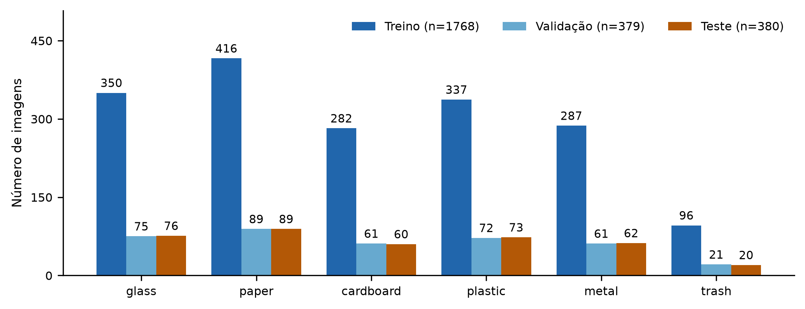
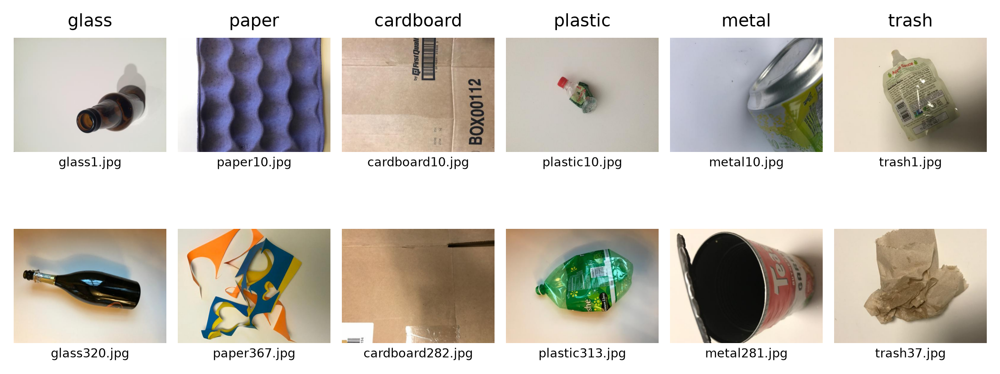
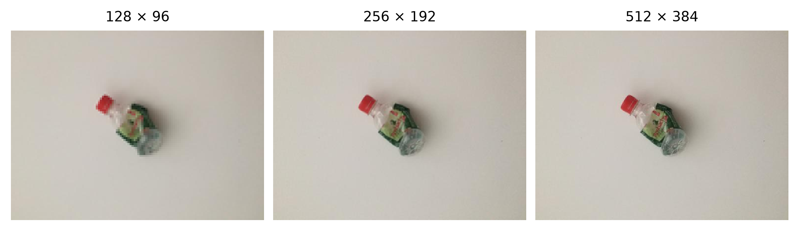
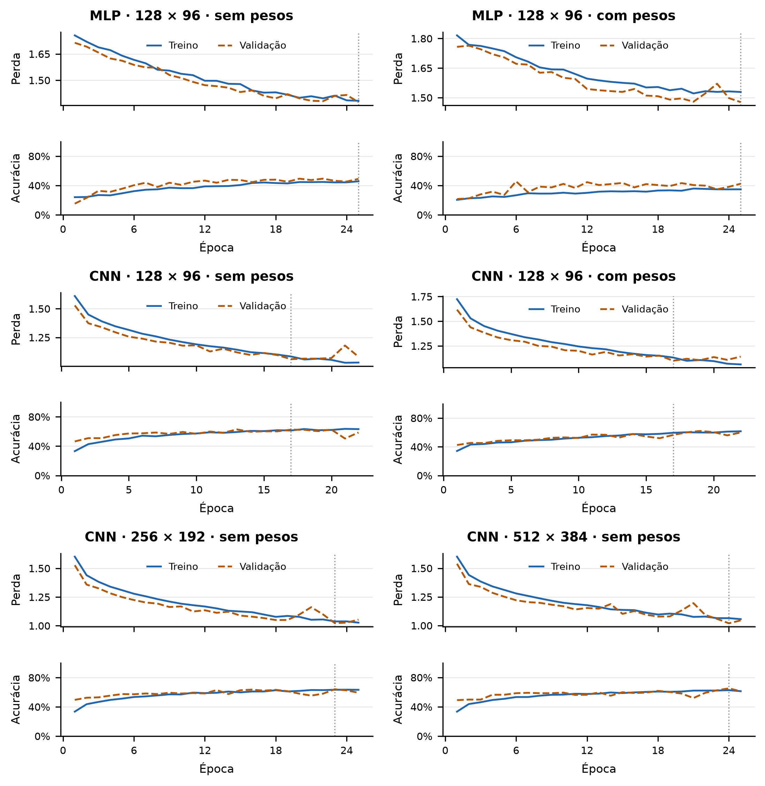
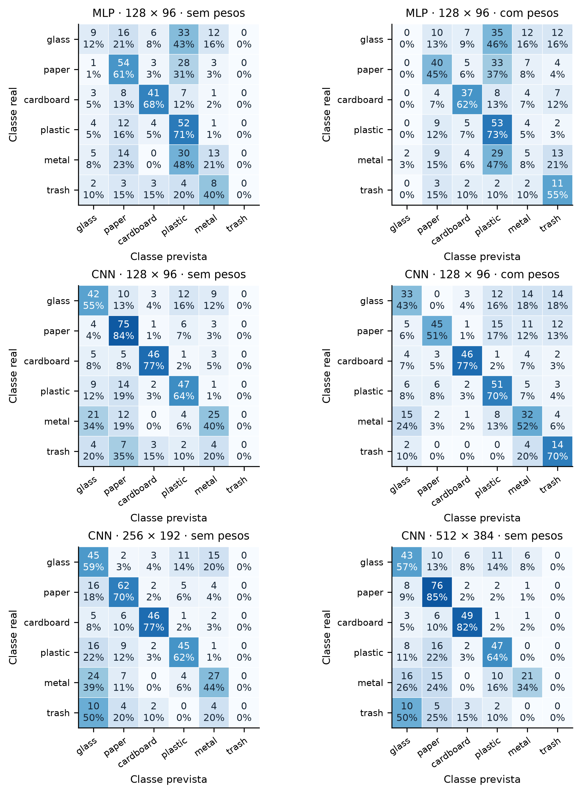
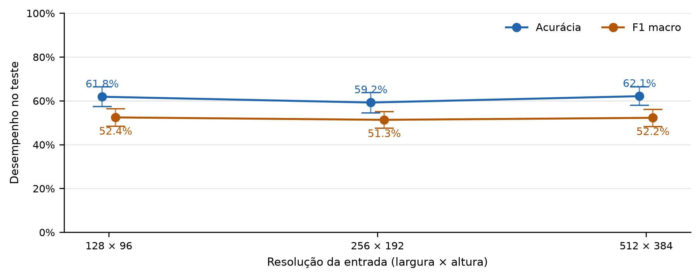
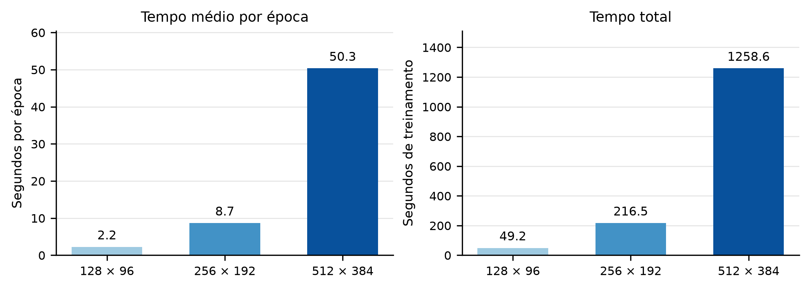
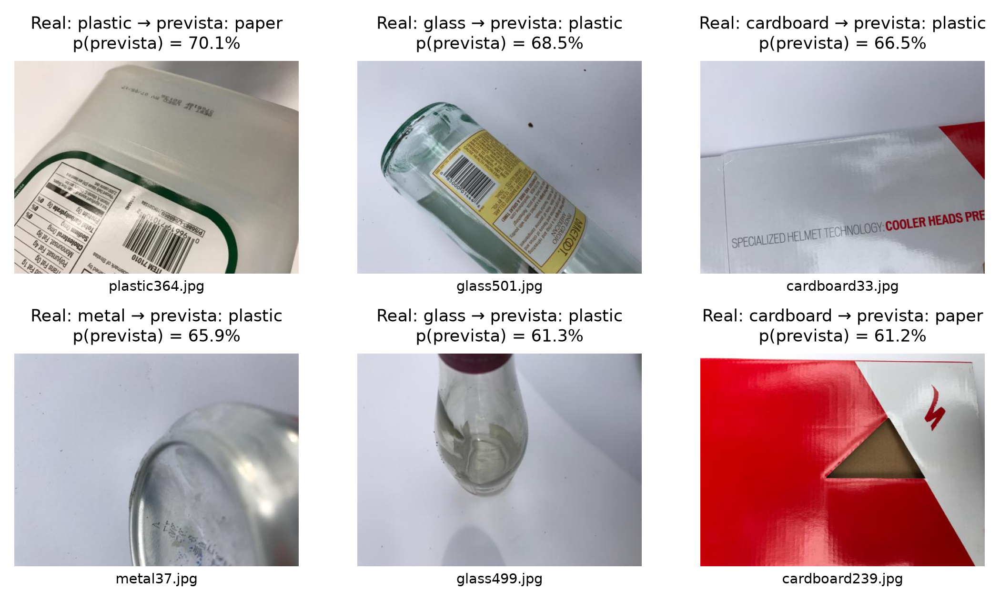

Classificação de resíduos com redes neurais: arquitetura, desequilíbrio e resolução no TrashNet
JOÃO VICTOR OLIVEIRA GOMES - matrícula 9999999
DANILLO CASTRO DE SOUSA - matrícula 9999999
PEDRO HENRIQUE CÂMARA MATOS - matrícula 9999999
LETÍCIA MONTEIRO VIDAL - matrícula 9999999
FRANCISCO VITOR RODRIGUES XAVIER - matrícula 9999999
Atividade final - Redes Neurais Artificiais
Repositório GitHub: publicação pendente; inserir o endereço público antes da submissão.
Versão para revisão da equipe. Matrículas provisórias informadas pelos autores.

## Resumo

Este estudo compara MLP e CNN na classificação de 2.527 imagens do TrashNet, preservando seis classes. Foram realizados seis experimentos controlados com pesos de classe e três resoluções. A divisão estratificada foi corrigida para agrupar três pares de imagens idênticas com rótulos conflitantes. A CNN em 128 × 96 com pesos de classe, selecionada exclusivamente pelo F1 macro de validação, obteve 58,16% de acurácia e 0,5718 de F1 macro no teste. A análise relaciona desempenho, desequilíbrio, custo e limitações de generalização.

Palavras-chave: redes neurais; classificação de resíduos; TrashNet; desequilíbrio de classes.

## 1 Introdução

A classificação visual de resíduos pode apoiar a triagem, mas materiais distintos compartilham formas, cores e embalagens. O TrashNet oferece um cenário inicial para estudar esse problema (Thung; Yang, 2016). O objetivo é comparar uma rede totalmente conectada (MLP) e uma rede convolucional (CNN), investigar o efeito de pesos na perda e avaliar se a maior resolução compensa seu custo computacional. O estudo mede classificação de imagens inteiras, sem localizar objetos.

## 2 Materiais e métodos

Foi usado apenas dataset-resized.zip. A inspeção confirmou 2.527 imagens RGB de 512 × 384 pixels e nenhuma imagem inválida; três arquivos auxiliares macOS foram ignorados. Mantiveram-se vidro (glass), papel (paper), papelão (cardboard), plástico (plastic), metal e outros resíduos (trash). SHA-256 do ZIP, hashes de bytes e pixels e o manifesto da divisão estão preservados no projeto.

---

## 2.1 Divisão, pré-processamento e controle

A semente 42 foi usada em duas divisões estratificadas (70/30 e 50/50 do restante): 1.768 imagens de treino, 379 de validação e 380 de teste. Três pares idênticos tinham rótulos conflitantes. Cada grupo foi ancorado na partição de sua primeira linha na ordenação fixa. Uma troca entre plastic332.jpg e plastic1.jpg preservou as contagens por classe; todos os pares ficaram no treino. Os rótulos originais foram mantidos, portanto permanece ruído de anotação.

As imagens foram orientadas por EXIF, convertidas para RGB e redimensionadas diretamente da referência por LANCZOS; tensores float32 em C × A × L foram divididos por 255. Não houve aumento de dados nem reamostragem. Essa decisão mantém o contraste entre pesos de classe isolado. A interpolação usa Pillow (Pillow Contributors, s.d.).

## 2.2 Arquiteturas e treinamento

Tabela 1 - Arquiteturas e quantidade de parâmetros treináveis.

| Rede | Camadas | Parâmetros |
| --- | --- | --- |
| MLP | 36.864 entradas → 128 ReLU → dropout 0,2 → 64 ReLU → dropout 0,2 → 6 logits | 4.727.366 |
| CNN | Conv 3×3 com 16, 32 e 64 filtros; BatchNorm, ReLU e MaxPool 2×2 em cada bloco; GAP → 6 logits | 24.086 |

Fonte: Elaboração a partir dos registros experimentais (2026).

Na CNN, a primeira convolução tem passo 2; as demais, passo 1; todas usam padding 1 e não usam bias. GAP reduz cada mapa à sua média espacial, conservando o número de parâmetros nas três resoluções. A MLP representa uma referência sem estrutura espacial explícita; a CNN compartilha filtros locais. As redes foram implementadas em PyTorch (PyTorch Contributors, s.d.).

Adotaram-se Adam (passos adaptativos), taxa comum 0,0001, lote 32 (viável em CPU nas três resoluções) e limite de 25 épocas. A entropia cruzada é apropriada às seis classes mutuamente exclusivas e recebe logits (PyTorch Contributors, s.d.). Sem pré-treinamento, cada rede reiniciou a semente 42 e a inicialização padrão do PyTorch; hashes confirmam pesos iniciais idênticos nos pares. Não houve weight decay ou agendador.

Nos treinos ponderados, wc = 1.768/(6nc), usando apenas o treino: glass=0,842, paper=0,708, cardboard=1,045, plastic=0,874, metal=1,027, trash=3,069. A perda média divide a soma das perdas ponderadas pela soma dos pesos dos exemplos.

## 2.3 Busca exploratória e escolha dos modelos

Tabela 2 - Busca em 128 × 96 sem pesos; somente validação.

| Taxa Adam | F1 val. MLP | F1 val. CNN | Média |
| --- | --- | --- | --- |
| 0,001 | 0,1385 | 0,5078 | 0,3232 |
| 0,0003 | 0,3013 | 0,5356 | 0,4184 |
| 0,0001 | 0,3944 | 0,5337 | 0,4641 |

Fonte: Elaboração a partir dos registros experimentais (2026).

Após baixa aprendizagem na MLP inicial, três taxas foram comparadas pela média do F1 macro de validação das duas redes, nos checkpoints de menor perda; empates seguiriam a ordem da tabela. Os seis treinos finais foram reiniciados com a taxa escolhida. Early stopping (perda de validação, paciência 5, min_delta=0) limita custo e evita manter pesos após a deterioração da validação. Entre os seis checkpoints restaurados, o maior F1 macro de validação define o modelo principal; hashes e escolhas foram congelados antes do teste.

---

## 3 Resultados

A Figura 1 confirma a estratificação. Trash representa 137/2.527 imagens (5,42%), contra 594 de paper; a razão entre a maior e a menor classe é 4,34. Arredondamentos inteiros explicam as pequenas diferenças em relação a 70/15/15.

Figura 1 - Distribuição das seis classes em treinamento, validação e teste.

Fonte: Elaboração a partir dos registros experimentais (2026).

Figura 2 - Dois exemplos de treinamento por classe, escolhidos por uma regra fixa.

Fonte: TrashNet (Thung; Yang, 2016), organizado neste estudo.

Vidro e plástico podem compartilhar o formato de garrafas; papel e papelão apresentam texturas semelhantes. Rótulos, amassados, reflexos, sombras e a classe heterogênea trash dificultam a discriminação visual (Figura 2).

Figura 3 - A mesma imagem de treino, plastic10.jpg, nas três resoluções.

Fonte: TrashNet (Thung; Yang, 2016); redimensionamento do estudo.

Na Figura 3, os painéis têm o mesmo tamanho físico para expor a perda de detalhe. Cada entrada foi gerada diretamente da referência, preservando a proporção 4:3.

---

## 3.1 Desempenho global e custo

Tabela 3 - Resultados dos seis checkpoints no mesmo teste (n=380); F1 sempre macro.

| ID / experimento | F1 val. | Acurácia teste | F1 teste | Época salva |
| --- | --- | --- | --- | --- |
| M1 - MLP 128×96 sem pesos | 0,3944 | 44,47% | 0,3583 | 25 |
| M2 - MLP 128×96 com pesos | 0,3716 | 38,42% | 0,3304 | 25 |
| M3 - CNN 128×96 sem pesos | 0,5337 | 61,84% | 0,5241 | 17 |
| M4 - CNN 128×96 com pesos | 0,5591 | 58,16% | 0,5718 | 17 |
| M5 - CNN 256×192 sem pesos | 0,5511 | 59,21% | 0,5131 | 23 |
| M6 - CNN 512×384 sem pesos | 0,5493 | 62,11% | 0,5223 | 24 |

Fonte: Elaboração a partir dos registros experimentais (2026).

O maior F1 macro de validação foi o de M4 (0,5591), escolhido antes de consultar o teste. Seu F1 macro de teste foi 0,5718, com intervalo percentil de 95% [0,5243; 0,6181]. Acurácia e F1 macro são complementares: o segundo dá o mesmo peso às seis classes.

Tabela 4 - Custos medidos na etapa final, excluída a busca exploratória.

| ID | Parâmetros | MiB modelo | Épocas | Total (s) | s/época | RSS (MiB) |
| --- | --- | --- | --- | --- | --- | --- |
| M1 | 4.727.366 | 18,037 | 25 | 56,7 | 2,27 | 661,2 |
| M2 | 4.727.366 | 18,037 | 25 | 60,4 | 2,42 | 662,9 |
| M3 | 24.086 | 0,100 | 22 | 49,2 | 2,24 | 596,1 |
| M4 | 24.086 | 0,100 | 22 | 50,9 | 2,31 | 594,2 |
| M5 | 24.086 | 0,100 | 25 | 216,5 | 8,66 | 1015,5 |
| M6 | 24.086 | 0,100 | 25 | 1258,6 | 50,34 | 2371,8 |

Fonte: Elaboração a partir dos registros experimentais (2026).

Hardware: Intel Core i3-1125G4, quatro núcleos físicos, oito lógicos e 14,8 GiB de RAM total. Foram usados CPU, quatro threads, PyTorch 2.14.1+cpu, Python 3.12.14 e lote 32 em todos os casos. Não houve redução de lote nas resoluções maiores.

O cronômetro perf_counter incluiu treino, validação por época e checkpoints; excluiu download, preparação dos caches, inicialização e avaliação final. A média é tempo total/épocas concluídas. RSS é o pico absoluto do processo, amostrado a cada 50 ms por psutil (Rodola, s.d.), incluindo páginas do cache mapeadas; não é a memória de toda a máquina. Não houve GPU. O tamanho em MiB considera model.pt, apenas pesos e buffers, não o estado do otimizador.

Os tempos são medições de uma execução em computador de uso geral e podem variar com carga de fundo, cache e temperatura. Os intervalos de desempenho usam 2.000 reamostragens estratificadas do teste, semente 20261127. Expressam incerteza amostral condicionada aos modelos, sem incluir variação entre sementes de treino ou mudança de domínio.

---

## 3.2 Curvas de aprendizagem

Figura 4 - Perda e acurácia de treino e validação dos seis experimentos.

Fonte: Elaboração a partir dos registros experimentais (2026).

A linha vertical indica a época restaurada por menor perda de validação. O término da curva pode ocorrer depois dela, pois a paciência aguarda cinco épocas sem melhora. As métricas de treino foram agregadas durante atualizações, com dropout ativo na MLP; as de validação usam modo de avaliação. Portanto, validação acima de treino em alguns pontos não é, isoladamente, sinal de vazamento.

As MLPs completaram 25 épocas e salvaram a última: a perda de validação caiu de 1,714 para 1,375 sem pesos e de 1,758 para 1,478 com pesos. A redução até o limite não demonstra convergência nem sobreajuste persistente. Nas CNNs 128, ambas salvaram a época 17 e pararam na 22: o treino continuou melhorando sem nova mínima de validação. Na CNN ponderada, a acurácia de validação cresceu de 56,46% para 59,89% nesse intervalo, mas a perda piorou de 1,100 para 1,141. A divergência entre critérios ilustra por que recuperar a menor perda pode não recuperar a maior acurácia. As CNNs 256 e 512 completaram 25 épocas e restauraram, respectivamente, as épocas 23 e 24.

---

## 3.3 Matrizes de confusão

Figura 5 - Contagens e porcentagens por linha nos seis experimentos.

Fonte: Elaboração a partir dos registros experimentais (2026).

Linhas: classe real; colunas: classe prevista. Cada porcentagem divide a contagem pelo suporte da classe real; arredondamentos podem impedir soma exata de 100%. A ordem das classes é fixa em todos os painéis.

---

## 3.4 Métricas por classe

Tabela 5 - Precisão, recall, F1 e suporte de cada classe no teste.

| Modelo | Classe | Precisão | Recall | F1 | Suporte |
| --- | --- | --- | --- | --- | --- |
| M1 | glass | 0,375 | 0,118 | 0,180 | 76 |
|  | paper | 0,505 | 0,607 | 0,551 | 89 |
|  | cardboard | 0,719 | 0,683 | 0,701 | 60 |
|  | plastic | 0,338 | 0,712 | 0,458 | 73 |
|  | metal | 0,342 | 0,210 | 0,260 | 62 |
|  | trash | 0,000 | 0,000 | 0,000 | 20 |
| M2 | glass | 0,000 | 0,000 | 0,000 | 76 |
|  | paper | 0,533 | 0,449 | 0,488 | 89 |
|  | cardboard | 0,617 | 0,617 | 0,617 | 60 |
|  | plastic | 0,331 | 0,726 | 0,455 | 73 |
|  | metal | 0,147 | 0,081 | 0,104 | 62 |
|  | trash | 0,224 | 0,550 | 0,319 | 20 |
| M3 | glass | 0,494 | 0,553 | 0,522 | 76 |
|  | paper | 0,610 | 0,843 | 0,708 | 89 |
|  | cardboard | 0,836 | 0,767 | 0,800 | 60 |
|  | plastic | 0,653 | 0,644 | 0,648 | 73 |
|  | metal | 0,556 | 0,403 | 0,467 | 62 |
|  | trash | 0,000 | 0,000 | 0,000 | 20 |
| M4 | glass | 0,508 | 0,434 | 0,468 | 76 |
|  | paper | 0,804 | 0,506 | 0,621 | 89 |
|  | cardboard | 0,868 | 0,767 | 0,814 | 60 |
|  | plastic | 0,586 | 0,699 | 0,638 | 73 |
|  | metal | 0,457 | 0,516 | 0,485 | 62 |
|  | trash | 0,286 | 0,700 | 0,406 | 20 |
| M5 | glass | 0,388 | 0,592 | 0,469 | 76 |
|  | paper | 0,689 | 0,697 | 0,693 | 89 |
|  | cardboard | 0,836 | 0,767 | 0,800 | 60 |
|  | plastic | 0,682 | 0,616 | 0,647 | 73 |
|  | metal | 0,509 | 0,435 | 0,470 | 62 |
|  | trash | 0,000 | 0,000 | 0,000 | 20 |
| M6 | glass | 0,489 | 0,566 | 0,524 | 76 |
|  | paper | 0,594 | 0,854 | 0,700 | 89 |
|  | cardboard | 0,790 | 0,817 | 0,803 | 60 |
|  | plastic | 0,644 | 0,644 | 0,644 | 73 |
|  | metal | 0,724 | 0,339 | 0,462 | 62 |
|  | trash | 0,000 | 0,000 | 0,000 | 20 |

Fonte: Elaboração a partir dos registros experimentais (2026).

Suporte é o número de exemplos da classe avaliada. F1 macro é a média aritmética dos seis F1, calculados por 2TP/(2TP+FP+FN). Os rótulos 0 a 5 são sempre explícitos e zero_division=0 trata divisões indefinidas (Scikit-learn Developers, s.d.). Não houve previsão para M1: trash; M3: trash; M5: trash; M6: trash. A precisão indefinida dessas classes foi registrada como zero; isso não elimina seu peso no F1 macro.

---

## 4 Discussão

Em 128 × 96, a diferença CNN menos MLP no F1 macro de teste foi 0,1658 sem pesos e 0,2414 com pesos. Essas diferenças descrevem as arquiteturas e o orçamento adotados, sem estabelecer superioridade universal.

Tabela 6 - Efeito dos pesos: valor ponderado menos valor sem pesos.

| Arquitetura | Δ F1 macro | Δ recall trash | Δ F1 trash |
| --- | --- | --- | --- |
| MLP | -0,0279 | 0,550 | 0,319 |
| CNN | 0,0477 | 0,700 | 0,406 |

Fonte: Elaboração a partir dos registros experimentais (2026).

Na CNN, ponderar elevou o recall de trash de 0 para 70% (14/20), mas sua precisão foi 28,57%: 35 das 49 previsões trash eram de outras classes. O recall de paper caiu de 84,27% para 50,56%; a acurácia global caiu 3,68 pontos percentuais, enquanto F1 macro subiu 4,77 pontos. Na MLP, trash passou a ter 11 acertos, mas glass ficou sem acertos e o F1 macro caiu 2,79 pontos. O benefício depende da arquitetura e da classe.

Figura 6 - CNN sem pesos: desempenho no teste e intervalos bootstrap de 95%.

Fonte: Elaboração a partir dos registros experimentais (2026).

Figura 7 - CNN sem pesos: custo médio por época e tempo total.

Fonte: Elaboração a partir dos registros experimentais (2026).

Em 512 × 384 houve apenas um acerto adicional em 380 imagens: 236 contra 235 em 128 × 96. O F1 macro caiu de 0,5241 para 0,5223; 256 × 192 também não melhorou o teste. Com 16 vezes mais pixels e os mesmos 24.086 parâmetros, 512 × 384 custou 22,52 vezes mais por época, 25,59 vezes no total e 3,98 vezes em RSS. Neste protocolo, 128 × 96 ofereceu a melhor relação entre F1 e custo entre as CNNs sem pesos; aumentar a resolução não compensou.

---

## 4.1 Erros e limitações para aplicação

Figura 8 - Seis erros de M4, escolhido exclusivamente pela validação.

Fonte: Imagens do TrashNet (Thung; Yang, 2016); previsões do modelo selecionado.

O modelo selecionado errou 159 das 380 imagens de teste. O painel mostra até seis erros com maior probabilidade atribuída à classe prevista, com desempate pelo caminho do arquivo. Esse critério expõe erros de alta probabilidade, não uma amostra representativa de todos os erros. Softmax não equivale a confiança calibrada.

Em plastic364, o grande rótulo impresso ocupa parte da embalagem prevista como papel. Glass501 e glass499 são garrafas transparentes previstas como plástico. Cardboard33 apresenta superfície lisa e brilhante; metal37 mostra apenas parte de uma superfície curva refletiva: ambos foram previstos como plástico. Cardboard239, previsto como papel, exibe impressão colorida sobre a caixa. São hipóteses visuais de ambiguidade, sem prova de quais atributos a rede utilizou.

Na matriz de M4, paper → plastic e metal → glass somam 15 erros cada; glass → metal e glass → trash têm 14 cada. O painel de alta probabilidade não reproduz necessariamente essa frequência. Ruído nos rótulos de treino e semelhança entre embalagens limitam a interpretação, mesmo sem cópias exatas atravessando as partições.

O domínio é restrito: objetos geralmente isolados, fundos claros e pouca diversidade de cenários. Não houve avaliação externa com lixo misturado, oclusão, sujeira, múltiplos objetos ou novas câmeras. A classe trash agrega objetos distintos e a distribuição real pode diferir. Assim, os resultados não demonstram prontidão para uma esteira de triagem ou para decidir a reciclabilidade local de cada embalagem.

Há uma única semente e uma única divisão. Hashes não identificam todas as fotos diferentes do mesmo objeto; a independência por instância não é garantida. A busca exploratória também reutiliza a validação e pode se ajustar a ela. Repetições com sementes distintas, avaliação por objeto e um conjunto externo constituem próximos passos, sem reinterpretar o teste atual como validação.

---

## 4.2 Comparação com o estudo de referência

Yang e Thung (2016) reportaram 63% de acurácia com SVM e seis classes, usando 70/30 para treino/teste, e 22% com CNN após excluir trash, com cinco classes, entrada 256 × 256 e divisão 70/13/17. Aqui há seis classes, divisão 70/15/15 aproximada, outra arquitetura e treinamento. Esses valores são contexto histórico, não comparação controlada. Os aproximadamente 75% de CNN citados no README do TrashNet pertencem à continuação posterior dos experimentos (Thung; Yang, 2016).

## 5 Conclusão

O estudo executou os seis contrastes com divisão comum, inicializações controladas e teste reservado. As CNNs superaram as MLPs no F1 macro em ambos os pares de 128 × 96. A CNN ponderada, escolhida pela validação, atingiu F1 macro de teste 0,5718: recuperou trash, com perdas em outras classes. A ponderação prejudicou o F1 macro da MLP. Nas CNNs sem pesos, a maior resolução não compensou seu custo. Essas conclusões se restringem à divisão, semente e orçamento adotados. Repetições, aumento de dados, transferência de aprendizagem e avaliação externa são próximos passos. A extensão opcional YOLO não foi realizada.

Tabelas e figuras usam NumPy, pandas e Matplotlib (NumPy Developers, s.d.; Pandas Development Team, s.d.; Matplotlib Development Team, s.d.). Código, modelos, históricos e previsões acompanham o artigo. A elaboração recebeu assistência de IA; a conferência, compreensão e revisão pelos integrantes permanecem necessárias antes da submissão.

## Referências

MATPLOTLIB DEVELOPMENT TEAM. Matplotlib documentation. [S. l.], [s. d.]. Disponível em: https://matplotlib.org/stable/. Acesso em: 16 out. 2026.

NUMPY DEVELOPERS. NumPy documentation. [S. l.], [s. d.]. Disponível em: https://numpy.org/doc/stable/. Acesso em: 16 out. 2026.

PANDAS DEVELOPMENT TEAM. pandas documentation. [S. l.], [s. d.]. Disponível em: https://pandas.pydata.org/docs/. Acesso em: 17 out. 2026.

PILLOW CONTRIBUTORS. Image module. In: Pillow documentation. [S. l.], [s. d.]. Disponível em: https://pillow.readthedocs.io/en/stable/reference/Image.html. Acesso em: 16 out. 2026.

PYTORCH CONTRIBUTORS. CrossEntropyLoss. In: PyTorch documentation. [S. l.], [s. d.]. Disponível em: https://docs.pytorch.org/docs/stable/generated/torch.nn.CrossEntropyLoss.html. Acesso em: 16 out. 2026.

RODOLA, Giampaolo. psutil documentation. [S. l.], [s. d.]. Disponível em: https://psutil.readthedocs.io/stable/. Acesso em: 17 out. 2026.

SCIKIT-LEARN DEVELOPERS. classification_report. In: Scikit-learn documentation. [S. l.], [s. d.]. Disponível em: https://scikit-learn.org/stable/modules/generated/sklearn.metrics.classification_report.html. Acesso em: 16 out. 2026.

THUNG, Gary; YANG, Mindy. TrashNet. GitHub, [2016]. Disponível em: https://github.com/garythung/trashnet. Acesso em: 16 out. 2026.

YANG, Mindy; THUNG, Gary. Classification of trash for recyclability status. Stanford: Stanford University, 2016. Relatório de projeto, CS229. Disponível em: https://cs229.stanford.edu/proj2016/report/ThungYang-ClassificationOfTrashForRecyclabilityStatus-report.pdf. Acesso em: 16 out. 2026.

---
